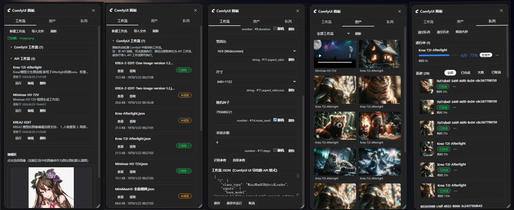

# dsh-comfyui

**English** | [中文](README.md)

<p align="center">
  
</p>

<h1 align="center">dsh-comfyui</h1>

<p align="center">Let the DeepSeek Harness agent smartly drive a local or remote ComfyUI to generate anything — with workflow and asset management panels, per-workflow skill packs, a companion skill and a same-origin media proxy.</p>

<p align="center">
  <a href="https://www.npmjs.com/package/dsh-comfyui"></a>
  <a href="https://www.npmjs.com/package/dsh-comfyui"></a>
  
</p>

> **Version pairing (pick the right dsh before installing, otherwise dshmarket shows a risk banner)**:
>
> | dsh-comfyui | Paired DeepSeek Harness | Notes |
> | --- | --- | --- |
> | **0.5.x (latest, `latest` tag)** | **>= 0.1.2, < 0.3** (incl. 0.1.5 / 0.1.6 / 0.1.7 / 0.2.x prereleases) | From 0.5.3 the settings page works with dsh 0.1.7's settings model (saves apply live, no restart); from 0.5.5 it supports dsh 0.2.x |
> | **0.3.x (beta line, `beta` tag)** | **0.1.1** | On older dsh versions stay on the 0.3.x line |
>
> Install: `dsh plugin --profile web add dsh-comfyui` (latest 0.5.x) / `dsh plugin --profile web add dsh-comfyui@beta` (0.3.x for older hosts).

## Features

### Agent tools

The agent drives ComfyUI directly, no canvas work needed:

- `comfyui_workflow` — **the main entry**: to generate, `list` the library and pick a workflow, then `run` it (by id + parameter overrides; misspelt keys are rejected, parameters not passed use their defaults). `list` also carries the server address, local ComfyUI dirs, load-area media and each workflow's parameter list; `skill` reads a workflow's skill pack on demand, `refresh` re-derives a parameter snapshot. `mode: "sync"` waits for the result, `mode: "async"` runs a background job (recommended for video/audio) — the agent ends its turn after submitting and is woken by the host on completion; once a run finishes, the agent pastes the ready-made Markdown media references from the result into its reply (the same for sync, async and PTC mode) with a one-sentence summary of what was generated; video/audio links get an inline player right below them.
- `comfyui_skill` — read and write workflow skill packs (`list` / `read` / `write` / `append` / `mkdir` / `rename` / `delete` / `enable` / `require`); the agent can write its lessons back into a pack and reuse them across sessions.
- `comfyui_object_info` + `comfyui_run` — **secondary**, for hand-written workflows only (temporary tests, or building a workflow for this environment): check the nodes and available models with `comfyui_object_info`, write the API JSON, run it with `comfyui_run`. Once it works, save it to the library with **New workflow** in the panel.

### UI panel

A right-docked panel with four tabs:

- **Workflows** — the runnable workflow library (create / edit / run / delete / import `.json`, tag classification with a dropdown filter); **preset export / import**: bundle selected workflows (all pre-selected; pack-bearing rows are annotated) with their parameters and skill packs into one `.zip` preset package — the completion notice reports what was actually packaged: workflow names, file name, size, and warnings; drag a preset package **onto the dialog** (or pick a file) to analyze it and import the selection, with skill packs restored byte-for-byte (thousand-file template packs included). Imports always create new workflows — nothing in the library is overwritten; auto-detects graphs saved on the ComfyUI server and can **extract** them into runnable workflows (whole / per component / main flow only when a canvas holds several independent flows).
- **Assets** — every generated result (cards show the workflow name and filename) with preview, download, and hover-to-delete (also removes the file from the ComfyUI output directory).
- **Queue** — live queue plus full history in five states, with delete / interrupt / rerun / clear / free-memory actions; plugin-submitted jobs show a progress bar and preview.
- **Library** — lists every model the local ComfyUI can load, **grouped by type** (Checkpoint / LoRA / VAE / VAE Approx / Diffusion Model / Text Encoder / ControlNet / Upscale / Detection …), showing format, size and subdirectory, with search and a type filter. Scan roots come from four places: ① the **ComfyUI directories** set in Settings (a ComfyUI install root, a bare `models` folder, one category folder, or the ComfyUI-Desktop tree with `ComfyUI-Shared/models` and `ComfyUI-Installs/*/ComfyUI/models`); ② `extra_model_paths.yaml` / `.yml` (including `base_path`, grouped under the configured category, so a shared folder named `ckpt` still appears as Checkpoint); ③ **the running ComfyUI's own folder list via `/experiment/models`**, the only way to see an SD-WebUI tree or models on another drive; ④ `<name>.metadata.json` sidecars written by ComfyUI-Desktop (`preview_url`). Thumbnails use a sibling `name.png` / `name.preview.png` / `name.safetensors.png` / `previews/name.png` (also `.mp4` / `.webm`); clicking a card opens the lightbox, and a card without an image shows a type badge. This is a pure local filesystem scan, so it **works without a running ComfyUI** (the server step is skipped); an empty state explains when no directory is configured or no models were found.

Clicking the "ComfyUI Panel" button in the session header probes the backend's connection to ComfyUI; a failed probe leaves the panel open, because the workflow library (with skill packs and preset import/export) lives in the plugin's own store and stays usable offline, while the ComfyUI-backed tabs (assets, queue, runs) report the failure. A toast at the top of the page explains why (with the concrete reason), asking you to start the local ComfyUI (so the backend can see its port) or check the remote server URL in settings; a healthy connection stays silent, with a brief "Connected" note only when it recovers from a failure.

<p align="center"></p>

### Detached window (drag the panel anywhere on screen)

The **⧉** button in the panel header tries to pop the whole panel out into its own operating-system window: drag it anywhere on screen, onto a second display, or keep it above other apps — no longer clipped by the DSH window viewport. **⇲** inside that window docks it back.

- The detached panel is rendered by a **second React root** (not a portal, not moved DOM): React 18 binds a root's delegated listeners to the `document` owning its container, so a cross-document portal paints but every button is dead. A fresh root inside the target document keeps interactions identical.
- Theme, stylesheets and `<base>` are copied over, so colors, images and videos (`/comfyui/media`) keep working; the lightbox keys (Esc / ← / →) and hover-paste listen on both documents.
- Two channels, in order: `window.open` (a real window; the host must whitelist the frame name `dsh-comfyui-panel`) then Document Picture-in-Picture (an always-on-top mini window; Electron 44 resolves the request and then tears the window down, hence the liveness check). The desktop shell is detected and skips PiP, where that channel cannot produce a window; an ordinary browser keeps the original unbounded wait, so a slow hand-over is never mistaken for a failure.
- **The installed DSH Desktop 0.2.1-rc.3 denies every `window.open`**: its main-process handler only hands http(s) URLs to the system browser and denies the rest, with no `dsh-comfyui-panel` whitelist. In that host ⧉ switches the panel to an **in-app floating** mode instead (centered and enlarged, dragging and resizing still work, ⇲ restores the old spot) and explains why under the header; opening the Web GUI in an ordinary browser still produces a real OS window.
- Closing the panel (✕) or leaving the session docks the window back — no orphan windows.

### Load area (media loader)

A media loader at the top of the Workflows tab, in the style of ComfyUI's LoadImage node: visual picking (with in-place playback for video/audio), paste/upload, and multiple slots. Filled slots fill the workflow's unset loader parameters in order — **the agent doesn't need to guess file names**; unset `width`/`height` auto-match the source image's size. Uploads are renamed by content hash (dedup).

The `loadArea` field of `comfyui_workflow list` exposes the slots and their contents to the agent.

### Workflow skill packs (a manual for the agent)

A parameter list tells the agent which knobs exist, not what the workflow is *for* or which step goes wrong. A complex workflow can carry a **skill pack** (enable it from the "Skill pack" button on the workflow card):

```
<data dir>/skills/<workflow>/
  SKILL.md          # main doc: when to use / key parameters / gotchas
  references/       # reference docs: style catalogs, troubleshooting
  assets/           # reference images etc (previewable in the panel)
```

- **Progressive disclosure, no resident context cost**: `comfyui_workflow list` shows one summary line → `action: skill` fetches the SKILL.md body once the workflow is chosen → a referenced document is read only when the body points at it. Dozens of workflows can carry full packs, and the daily context cost stays one line each.
- **Edited in the panel**: file list + editor, import (auto-bucketed by extension), custom subdirectories, image preview, and the whole pack root can be moved to another drive / a synced folder (the `技能包目录` setting).
- **The agent can write it too**: the `comfyui_skill` tool lets the agent read and author a pack — `append` a pitfall to SKILL.md and the next session (even another one) reuses that experience.
- **Read-before-run**: a "required" flag makes `run` refuse until the skill pack has been read in this session, with an error pointing to `action: skill`.

### Media proxy & settings

Generated files are served through a same-origin route (`/comfyui/media`) addressed by file name, independent of ComfyUI's in-memory history — old results keep opening after a restart or a history clear. The browser never touches ComfyUI directly: no CORS, no mixed content, and the API key never leaves the host.

The DH settings page gets a "ComfyUI" section: server address, API key env var name, local ComfyUI directories, media host, connection test and a zh/en UI language switch — applied immediately, no `cordis.yml` edits needed.

## Install

```sh
# web profile
dsh plugin --profile web add dsh-comfyui
# desktop profile
dsh plugin --profile desktop add dsh-comfyui
```

After restarting the app: a panel entry appears in the sidebar, a "ComfyUI" section in settings, and the agent gets all tools plus the companion skill right away.

## Usage

Just tell the agent, e.g.:

- "Draw a red cat with ComfyUI"
- "Turn this image into cyberpunk style"
- "Turn the anime image in the load area into a photorealistic portrait, same resolution"
- "Generate a 5-second clip: city at sunset"
- "Run my Krea-Afterlight saved in ComfyUI" (if the graph isn't extracted yet, the agent will ask you to **extract** it in the panel first)

For a remote ComfyUI behind an authenticated proxy, provide the key via credential storage or the `apiKeyEnv` env var (default `COMFYUI_API_KEY`) — it is resolved on the host and never sent to the browser.

## Configuration

`comfyui` section of `cordis.yml` (most is editable in the settings page):

| Key | Default | Description |
| --- | --- | --- |
| `baseUrl` | `http://127.0.0.1:8188` | ComfyUI server address |
| `apiKeyEnv` | `COMFYUI_API_KEY` | Optional API key env var / credential name |
| `dataDir` | *(DSH data dir)* | Where the workflow library and asset index live |
| `comfyuiDirs` | `[]` | Local ComfyUI install dirs (multiple allowed); the agent locates models, custom nodes, TTS voice libraries through these |
| `outputDir` | `''` (inferred) | ComfyUI output dir (used to locate files when deleting assets) |
| `mediaHost` | `''` (auto) | External base URL for generated media |
| `skillsDir` | `''` (default `dataDir/skills`) | Skill pack root (absolute path; a synced folder or VCS works) |

## Requirements

- DeepSeek Harness (`web` / `desktop` profile)
- A running [ComfyUI](https://github.com/comfystack/ComfyUI) server (default `http://127.0.0.1:8188`)

## License

MIT